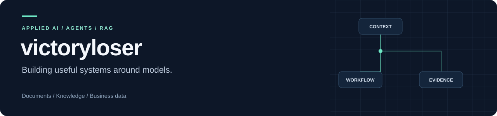

**Building practical AI systems for documents, knowledge, and business data.**

[Selected projects](#selected-projects) · [Engineering focus](#engineering-focus) · [Repositories](https://github.com/victoryloser?tab=repositories) · [简体中文](https://github.com/victoryloser/victoryloser/blob/main/README.zh-CN.md)

## What I build

My projects explore how to turn model capabilities into usable applications: connect the right context, make workflows explicit, and keep results inspectable.

- **Agent workflows:** structured planning, tool execution, conversation state, and review controls.
- **Retrieval and documents:** hybrid search, reranking, medical-document processing, and source-grounded answers.
- **Business and data tools:** conversational analytics, read-only SQL, and image-annotation utilities.

## Selected projects

<table>
<tr>
<td width="50%" valign="top">
<h3><a href="https://github.com/victoryloser/ecommerce-analysis-agent">Ecommerce Analysis Agent</a></h3>

Ask business questions, inspect computed results, and drill from a group into its details.

Natural-language queries · Chart drilldowns · Persistent sessions · Read-only SQL

<code>Python</code> <code>Gradio</code> <code>DuckDB</code>

<a href="https://github.com/victoryloser/ecommerce-analysis-agent#installation-and-startup">Quick start</a> · <a href="https://github.com/victoryloser/ecommerce-analysis-agent/blob/main/docs/data-format.md">Data format</a>

</td>
<td width="50%" valign="top">
<h3><a href="https://github.com/victoryloser/medical-agent-platform">Medical Agent Platform</a></h3>

Connect medical-document processing with retrieval, asynchronous jobs, and reviewable agent workflows.

OCR and de-identification · Hybrid RAG · Graph retrieval · Human review

<code>FastAPI</code> <code>LangGraph</code> <code>Milvus</code> <code>Neo4j</code>

<a href="https://github.com/victoryloser/medical-agent-platform#quick-start">Quick start</a> · <a href="https://github.com/victoryloser/medical-agent-platform/blob/main/docs/medical-architecture.md">Architecture</a>

</td>
</tr>
<tr>
<td width="50%" valign="top">
<h3><a href="https://github.com/victoryloser/medical-consultation-agent">Medical Consultation Agent</a></h3>

Explore text-and-image consultation workflows with emergency routing, retrieval, and explicit safety checks.

Multimodal input · Conditional routing · Evidence checks · Local/API models

<code>FastAPI</code> <code>LangGraph</code> <code>Gradio</code> <code>ChromaDB</code>

<a href="https://github.com/victoryloser/medical-consultation-agent#quick-start">Quick start</a> · <a href="https://github.com/victoryloser/medical-consultation-agent/blob/main/README.zh-CN.md">中文文档</a>

</td>
<td width="50%" valign="top">
<h3><a href="https://github.com/victoryloser/law_Rag">Labor Law RAG</a></h3>

Explore Chinese labor-law retrieval through hybrid search, reranking, query rewriting, and evaluation.

BM25 + vector retrieval · RRF · HyDE · Streaming API

<code>LlamaIndex</code> <code>ChromaDB</code> <code>FastAPI</code> <code>QLoRA</code>

<a href="https://github.com/victoryloser/law_Rag#quick-start">Quick start</a> · <a href="https://github.com/victoryloser/law_Rag/blob/master/README.zh-CN.md">中文文档</a>

</td>
</tr>
</table>

The medical and legal projects are learning and engineering projects. Their documentation describes usage boundaries and evaluation conditions.

## Engineering focus

| Area | What I focus on |
|---|---|
| Context and retrieval | Source references, hybrid retrieval, reranking, and query refinement |
| Workflow control | Explicit state, conditional routes, bounded execution, and human review where needed |
| Inspectable results | Calculation definitions, traces, evaluation scripts, and query records |
| Usable interfaces | APIs, Gradio interfaces, import flows, and practical setup documentation |

**Toolbox:** `Python` · `FastAPI` · `LangGraph` · `LlamaIndex` · `Gradio` · `DuckDB` · `ChromaDB` · `Milvus` · `Neo4j`

## More work

- [Annotation Data Tools](https://github.com/victoryloser/process_data): LabelMe merging and filtering, segmentation masks, image-mode inspection, and grayscale conversion.
- [Agent Runtime Kit](https://github.com/victoryloser/agent-runtime-kit): a **fork** of [zed123214/kitagent](https://github.com/zed123214/kitagent), kept separate from the project showcase above.

For questions or feedback, open an issue in the relevant repository.
